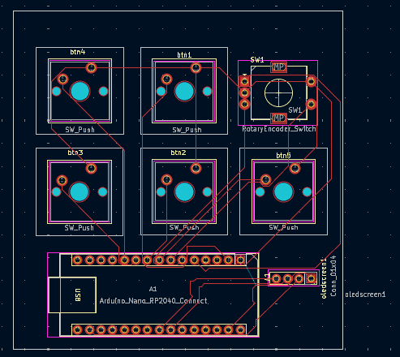

osu-macropad 🎮

A custom USB macropad designed in KiCad for osu!, gaming shortcuts, and everyday productivity.

Features

5 mechanical keyboard switches for programmable shortcuts

Arduino Nano RP2040 Connect as the controller

OLED screen for displaying status and modes

Planned rotary encoder for volume control and navigation

Custom PCB designed using KiCad

Hardware

Arduino Nano RP2040 Connect

5 MX-style mechanical switches (Gateron Milky Yellow Pro planned)

4-pin OLED display

Rotary encoder (replacement model to be selected)

Custom PCB

PCB Design

The schematic and PCB are currently under development. The schematic has passed KiCad's Electrical Rules Checker, but the physical PCB still needs footprint verification, routing, and design checks.

Firmware

See [`firmware/`](firmware/) — Arduino (Earle Philhower `arduino-pico` core + TinyUSB) firmware, verified to compile for the Nano RP2040 Connect.

* 5 keys (D0/D6/D7/D8/D5) as NKRO HID keyboard, 1 ms scan, 5 ms debounce
* EC11 encoder (D2/D3 + button D4): volume / layer control, short-press = mute, long-press = layer cycle
* SSD1306 OLED (SDA/A4, SCL/A5) showing layer, key state, CPS, volume
* 3 layers (osu! / MEDIA / WORK) persisted to LittleFS; edit the map in `firmware/keymap.h`

Build: open `firmware/firmware.ino` in Arduino IDE 2.x (board "Arduino Nano RP2040 Connect", USB Stack "Adafruit TinyUSB") or see `firmware/README.md` for `arduino-cli` commands.

Project Status

